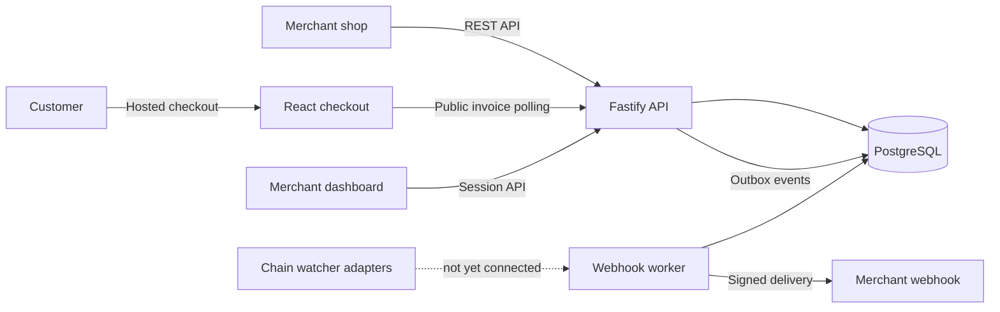

# ORBITT PAY


**Payments for every chain.** ORBITT PAY is a self-hosted, non-custodial crypto payment processor for online shops. Merchants configure public wallet keys; the service creates invoices, watches for payments, and sends signed webhooks.

ORBITT PAY is an early-stage project. This repository includes invoice and amount domain logic, public address derivation, a PostgreSQL-backed merchant API, cached exchange rates, chain-family watcher adapters, a signed webhook outbox worker, hosted checkout, a merchant dashboard, a JavaScript SDK, and a Docker Compose deployment.

**Do not use this version to process real payments.** Invoice allocation currently supports BTC, LTC, and native ETH. Chain watcher adapters exist, but the worker does not yet scan chains or advance invoice confirmations.

## Features

- Non-custodial architecture: merchant private keys and seed phrases are not stored by the service.
- Exact amount math uses integer base units and decimal exchange-rate calculations.
- PostgreSQL persistence, idempotent invoice creation, API key authentication, and OpenAPI documentation.
- HMAC-signed webhook delivery with an encrypted outbox and retry worker.
- Mobile hosted checkout with QR codes, payment URIs, countdown, and status polling.
- Session-protected merchant dashboard, JavaScript SDK, and Docker Compose self-hosting.

## Architecture



## Quick start

Requirements: Docker Engine and the Compose plugin.

```sh
cp .env.example .env
# Set POSTGRES_PASSWORD and APP_ENCRYPTION_KEY in .env.
docker compose up --build -d
```

Checkout is served at `http://localhost:8080`, the dashboard at `http://localhost:8081`, and API health at `http://localhost:8080/health`. Create a merchant key with:

```sh
docker compose exec api npm run api-key:create --workspace apps/api -- "Example Shop"
```

See [deployment instructions](./docs/deployment.md) for secret generation, dashboard-user creation, HTTPS setup, backup, and restore. See the [merchant integration guide](./docs/integration.md) to create invoices and verify webhooks.

## Development

Requirements: Node.js 22 LTS and npm.

```sh
cp .env.example .env
npm ci
npm run typecheck
npm run lint
npm test
npm run build
```

The first invoice allocator supports BTC, LTC, and native ETH on configured EVM networks. Token, Solana, and Tron invoice allocation is not implemented yet.

## Current limitations

- The worker dispatches webhook outbox records but does not run chain scans, match transfers, update confirmation counts, or expire invoices.
- Testnet end-to-end payment verification has not been completed.
- Dashboard TOTP and payment timelines/manual webhook redelivery controls are outstanding.
- Read [chain watcher notes](./docs/chain-watchers.md), [security and legal notes](./docs/legal.md), and [architecture decisions](./docs/decisions.md) before evaluating the project.

## Security

Never put private keys, seed phrases, production API credentials, or populated `.env` files in this repository. Keep API keys and webhook signing secrets in a secret manager. See the [security notes](./docs/legal.md) and the [project requirements](./AGENT_BRIEF.md).

## License

Proprietary. All rights reserved. W-Digital (hallo@w-digital.eu). See [LICENSE](./LICENSE).
